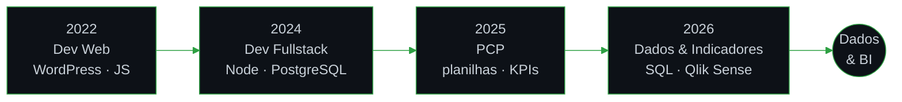

  

  

  
  
  
  

---

<h2 align="center">Sobre</h2>

  Estudante do 7º período de <b>Sistemas de Informação</b> na Unilasalle-RJ (conclusão em 2027/1), 
  com atuação em <b>análise de dados e indicadores</b>.

  No Tribunal de Justiça do Estado do Rio de Janeiro (TJRJ), trabalho com <b>SQL</b> e painéis de BI no <b>Qlik Sense</b> 
  para acompanhar indicadores processuais. No Hospital Icaraí, <b>desenvolvo KPIs</b> e consolido dados operacionais 
  que apoiam a gestão. Antes disso, atuei como desenvolvedor <b>web e fullstack</b>, o que me deu base em programação e banco de dados.

  Busco oportunidades de <b>estágio ou vaga júnior em Dados e BI</b>, presencial, híbrida ou remota. 
  Niterói, RJ.

<h2 align="center">Tecnologias</h2>

<b>Dados &amp; BI</b>

  
  
  
  
  
  

<b>Linguagens, bancos e ferramentas</b>

  

<b>Métodos</b>

  <code>Scrum</code> <code>Kanban</code> <code>BPMN</code> <code>UML</code> <code>Análise de Requisitos</code> <code>Modelagem de Processos</code> <code>Redes (IP, DHCP, TCP)</code>

## Experiência

| Cargo | Organização | Período |
|---|---|---|
| Estagiário · Dados e Análise de Indicadores | Tribunal de Justiça do Estado do Rio de Janeiro | mai/2026 – atual |
| Jovem Aprendiz · Administrativo | Hospital Icaraí | fev/2026 – atual |
| Jovem Aprendiz · Administrativo PCP | Jobal | ago/2025 – jan/2026 |
| Desenvolvedor Fullstack (estágio, remoto) | Lojas Quero-Quero | ago/2024 – nov/2024 |
| Desenvolvedor Web | Cal Marketing Digital | dez/2022 – jun/2023 |

<b>Detalhes</b>

 

**TJRJ:** extração e tratamento de dados com SQL para construção e acompanhamento de indicadores processuais (acervo, processos paralisados, metas do CNJ). Apoio na análise e validação de painéis de BI no Qlik Sense e na elaboração de relatórios para a gestão.

**Hospital Icaraí:** desenvolvimento de KPIs e consolidação de planilhas operacionais. Acompanhamento diário do indicador de pacientes com mais de 5 dias de internação (censo hospitalar + sistema MV) e levantamentos por setor: enxoval, consumo de insumos e plantões extras.

**Jobal:** planejamento e controle de produção. Ordens de produção, planilhas com dados da fábrica, relatórios semanais e criação de KPIs.

**Quero-Quero:** protótipos no Figma e sistemas web com HTML, CSS, JavaScript, Node.js, TypeScript e Python. Gerenciamento de banco PostgreSQL e análise de dados com Python.

**Cal Marketing Digital:** sites com WordPress, Elementor, HTML, CSS e JavaScript, como landing pages, formulários e carrosséis, com atenção a SEO.

## Projetos

| Projeto | Descrição | Stack |
|---|---|---|
| **Sistema de Gestão para ONG** · AVASP – Verbo Amar (2024) | Cadastro, listagem, atualização e exclusão de beneficiários, armazenamento de documentos e gestão de projetos. | `Python` `CustomTkinter` `MySQL` |
| **Gestão de Talões** · Lojas Quero-Quero (2024) | Protótipo web para envio e recebimento de talões entre lojas, com perfis de acesso, recuperação de senha e backend MVC. | `Node.js` `JavaScript` `PostgreSQL` |
| **Portfólio pessoal** *(em desenvolvimento)* | Site com projetos, experiências e contato. | `HTML` `CSS` `JavaScript` |
| **TCC** *(em desenvolvimento)* | Estudo de caso com dados do judiciário e dashboards de indicadores. | `SQL` `Qlik Sense` |

## Trajetória

## Cursos em andamento

| Curso | Instituição | Foco |
|---|---|---|
| **Python para Análise de Dados** | ENAJU · CNJ | Python aplicado à análise de dados |
| **Anotação de Dados para Modelos de Inteligência Artificial no Judiciário** (2026/1) | ENAJU · CNJ | Preparação e rotulagem de dados para IA |
| **Banco de Dados SQLite** | Origamid | SQL: modelagem, `CREATE TABLE`, `INSERT`, `SELECT` |
| **JavaScript Completo ES6** · **TypeScript para Iniciantes** · **Back End Node.js** | Origamid | Base de programação, tipagem e APIs |

## Em andamento

  

---

  

  Contato: <a href="https://www.linkedin.com/in/hugo-hlebetz-38a3881a9/">LinkedIn</a> · <a href="mailto:hugo.goncalves@soulasalle.com.br">hugo.goncalves@soulasalle.com.br</a>

